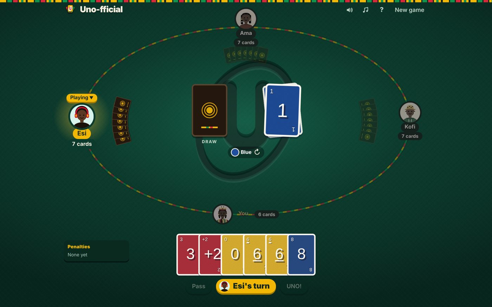
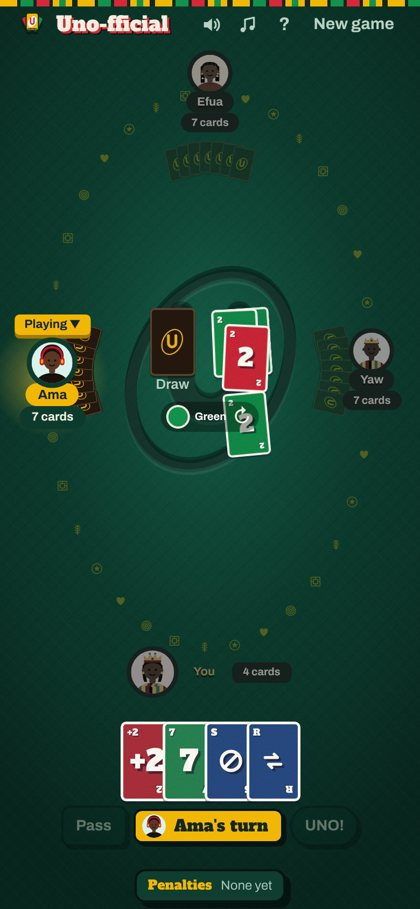

# Uno-fficial

**A colour-matching card game for friends, with a Ghanaian look and built-in voice chat.** Start a table, send the link, and everyone who opens it sits down to play and talk. No accounts, no downloads.

### ▶ [Play Uno-fficial](https://uno-fficial.onrender.com/)

<sub>Hosted on a free plan: after a quiet spell, the first visit can take about a minute while the server wakes up.</sub>

<p>
  
  
</p>

## The game

Match the top card by colour or symbol and be the first to empty your hand. A round plays on until one player is left holding cards, so every round has a winner, a finishing order and a loser.

On top of the classic deck, Uno-fficial adds a few cards and house rules my friends and I actually play with:

- **Blank Wild:** you choose who it hits and how: draw 2, 4 or 15, lose a turn, swap hands, or a dare you write yourself. The dare giver judges it, and skipping the dare costs 10 cards.
- **Wild +10, Swap Hands and Shuffle Hands:** one of each per game, so they stay special.
- **Double reverse:** put two reverses down together and you play again.
- **Stacking and jump-ins:** pass a +2 or +4 along, or jump in out of turn with an exact match.
- **Rule Roulette:** before each round the host spins a wheel for a twist borrowed from other UNO games, like *No Mercy: 25 and You're Out* or *Flip: Draw Five*, and the table votes to keep it or spin again.

## Features

- **One link per table.** Share it in any chat. Up to six seats, with computer players to fill gaps, and a waiting room for anyone who arrives mid-round.
- **Voice chat in the browser.** Tap the mic to talk; a ring lights up around whoever is speaking.
- **Music for the table.** The host pastes a YouTube or YouTube Music playlist and everyone hears it in sync.
- **Leaderboard** of wins and losses across rounds, and fresh seating every round.
- **Ghanaian design:** hand-painted signboard lettering, an emerald room ringed by gold Adinkra symbols that drift in the direction of play, and ten Gen Z player avatars, including a king and a queen.
- **Works on phones, tablets and computers**, including a layered hand when you're stuck with a lot of cards.
- **Practice mode** against the computer, anytime.

## How I built it

I designed Uno-fficial as a product first: I wrote the rules, chose the look and feel, and playtested it with friends, then turned what we noticed into the next round of changes (a fairer shuffle, limits on the brutal penalty cards, judged dares, a fix for a stacked-skip bug, tap handling on iPad). I built it with **Claude as an AI coding partner**: I set the direction and made the product and design calls, and Claude wrote and tested the code with me.

**Architecture**

```
 Browser (one HTML page)                     Node.js server (Render)
 ┌──────────────────────────┐   WebSocket   ┌──────────────────────────────┐
 │ table UI, animations     │ ◀───────────▶ │ one room per game link       │
 │ practice mode (local     │   moves in,   │ authoritative game state     │
 │   copy of the engine)    │   each player │ computer players, turn timer │
 │ voice: WebRTC audio ─────┼──┐ gets only  │ voice signalling relay       │
 │ music: YouTube player    │  │ their view │ shared music clock           │
 └──────────────────────────┘  │            └──────────────────────────────┘
                               └──▶ audio goes browser to browser
```

- **Server-authoritative rules.** The browser only sends moves. The server runs the game engine, validates every move, and sends each player a version of the state with everyone else's hand hidden, so nobody can peek or cheat from the browser.
- **One shared engine.** `engine.js` is pure rules, no UI: the same code runs on the server for online games and in the page for practice mode. I checked rule changes by simulating hundreds of computer-only games for stuck turns and broken states.
- **Real-time play** over WebSockets, with turn timers, reconnection, host hand-over, and computer players taking over for anyone who drops out.
- **Voice chat** with WebRTC: the server only relays the connection set-up messages, then audio flows directly between browsers.
- **Synced music** through the YouTube IFrame Player API, following YouTube's player rules.
- **Plain JavaScript, HTML and CSS**, no framework, in a single page; continuous deployment to Render from this repository.

| File | What it does |
| --- | --- |
| `public/index.html` | The whole game page: home screen, practice mode, lobby, table, voice chat |
| `server.js` | Runs each table, hides hands, plays computer players, relays voice set-up |
| `engine.js` | The card rules, shared by the server and practice mode |
| `rules.js` | Rule Roulette twists, plus optional AI-generated twists |

**Run it locally:** with Node.js 20+, run `npm install` then `npm start`, and open http://localhost:3000. Hosting notes are in [DEPLOY.md](DEPLOY.md).

---

Made by **Amanda Lucy Mensah** · [LinkedIn](https://www.linkedin.com/in/amanda-lucy-mensah-97839212b)
